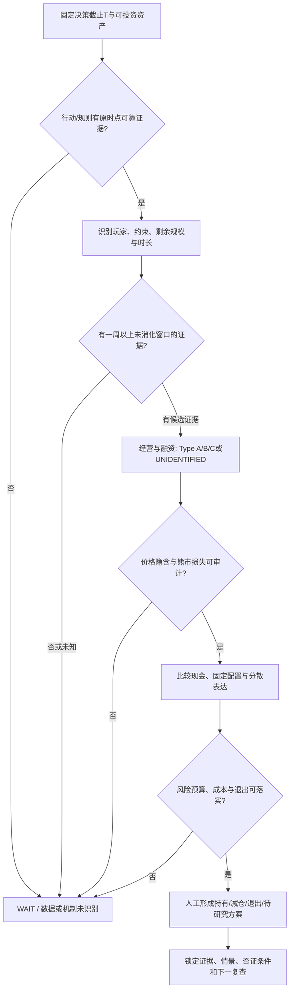

# 人类投资决策架构：可以更新，可以等待，可以承认不知道

Phase4 v001，2026-10-10；**LEVEL 1 — MECHANISM PLAUSIBLE**。**这是研究问树，不是统一评分、自动BUY或个人仓位建议。** 新操作原则0；`validated_principles`仍由root对既有冻结框架核验。本框架未生成任何新概率预测；不能为填表虚构55%、70%或“先买10%”。

## 一张可复查的决策单

|问题|必须写出的材料|未知时怎样处理|
|---|---|---|
|WHO 谁改变边际仓位？|控制钱者、资金来源、实际参与者与可验证动作|UNIDENTIFIED；大持有人名单不能替代边际动作|
|WHY 为什么现在？|可核验新信息/规则/义务和触发时刻|区分意图与执行，列其他解释|
|CONSTRAINT 有无选择？|赎回、合同、追保、mandate/容忍带及是否已经触发|Voluntary/Forced/Unclear，别猜内部VaR|
|SIZE 还剩多少？|净毛、币种、已执行/未执行、分母流动性及对冲|null；不把上限或AUM写成订单|
|DURATION 能继续多久？|正式执行期限、资金来源、续约/暂停权、残余规模|范围需证据；“长期机构”不是期限|
|FUNDAMENTALS 长期价值变吗？|原收入/现金流、订单可取消性、资本周期、股东利润归属|Holder/Asset类无法识别，优先补资料|
|CREDIT 能否活到兑现？|债务到期、可用现金/授信、抵押/融资续接/对手方|资产价格未坏不等于再融资安全|
|EXPECTATIONS 已经计入什么？|原估值/市场预期、价格隐含的规模/时长/利润|PRICE_IN_UNIDENTIFIED，价格涨跌只作proxy|
|ASYMMETRY 赔率在哪？|Bull/Base/Bear的现金流路径、成本、现金/配置benchmark、尾部|不虚构目标价/概率；先描述可证伪路径|
|FAILURE PATH 怎样最可能错？|最强反证、事件失效/反转、行为无效但价格涨的负控|没有可观察否证条件则只留研究|
|POSITION SIZE 能承受什么？|本人明确最大可承受损失、相关性/流动性、融资与退出约束|风险预算未给，POSITION_NOT_DETERMINED|

## 机制与行动问树

“有候选证据”不是自动交易许可。本轮最高LEVEL2/3也不足以直接生成LEVEL4操作原则；若尚无可执行原则，输出 `RESEARCH_ONLY / NO-NEW-TRADE-PRINCIPLE`。价格趋势可提醒检查执行/融资，不因过去择时失败而偷改成新窗口救活。

## 概率树怎样使用

先固定结果事件，例如“未来3个月相对同市场基准扣已知成本为正”，并区分最终回报与触发融资危机。为每个节点列原时点证据、替代解释与概率来源；无已校准类似案例则填 **PROBABILITY_UNIDENTIFIED**。Bear/Base/Bull是互斥情景时才可谈和为100%的中心值；区间端点无需拼到100%，但必须存在可同时满足的概率集合。资料缺失不是50%的经验胜率。

把经济机制概率、收益方向概率与能在预算内执行的概率分开；“强卖真实”不等于“反弹有利”。未来新证据只能更新新日期决策，原锁定判断/概率不得修改。第一次真实forward尚未到期，不补造历史主观判断。

## HOLD / REDUCE / EXIT / WAIT

|判断类别|可事先定义的触发|需要防的误读|
|---|---|---|
|继续持有的研究方案|原机制和融资未破坏，价格隐含未超出证据支持；风险预算仍可承受|价格下跌不自动kill，但也不证明要加仓|
|减仓的研究方案|兑现已明显price-in；相关性/尾部/流动性与原预算不符；行为趋耗尽|单日波动不能伪装为已证实风险变化|
|退出的研究方案|现金流/融资thesis可核验失败、规则取消、未执行承诺撤回、利益归属改变|未来反弹不撤销当时有效否证，必须保留卖错案例|
|WAIT / 不新增风险|关键主体/现金/融资/预期未识别，窗口短于一周，或现金/分散配置机会成本无法胜过|不把WAIT表现挑好年份；记录漏掉赢家与再进入条件|

卖出有逻辑、估值、组合风险和执行四种理由，应分别写。不能用一个stop-loss阈值代替这四个问题，也不能因“长期价值”忽视自身短负债。

## 仓位与复查

只有用户/组合提供真实风险预算与可承受损失后，才讨论总暴露、同一宏观/融资链相关性和无法退出时损失。不得以未经校准的胜率算Kelly，不给统一仓位数或强制满仓。现金/短债是正式可比表达，但不把wait当作保证收益。

保存T、来源、KNOWN_AT_T/KNOWN_ONLY_AFTER_T、Type、情景/概率状态、基准、费用、kill条件与下一次公开资料节点。复查最快一周；实际紧急融资约束可使事先计划不可执行，单独记录，不伪装为lab高频优势。任何研究晋升必须先主动查同动作失败、无动作赢家、跨市场规则失效与beta解释。

优先连读 `CONSTRAINED_CAPITAL_FRAMEWORK.md`、`PANIC_AND_FORCED_LIQUIDATION_FRAMEWORK.md`、`EXPECTATION_GAP_FRAMEWORK.md`、`MARKET_FOOTPRINTS.md` 与 `RULE_CHANGE_MONITOR.md`。旧负证据在 `FAILED_HYPOTHESES.md` 和 `PHASE3_RESEARCH_REPORT.md`，不会因新问树消失。
