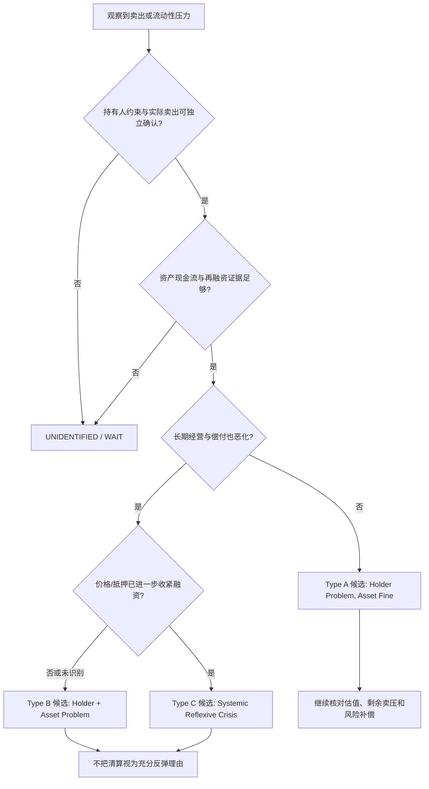

# 恐慌与强制清算：持有人问题，还是资产问题？

Phase4 v001；**LEVEL 1 — MECHANISM PLAUSIBLE**。本文不把任何已知反弹定为错杀。已锁事件集与实际结果由独立事件报告提供；本文只定义事前分类、证据缺口与反证。Phase3“大跌就是便宜”“信用不收紧就安全”均未成为原则。

“Asset Fine”是需要证明的工作命题，不是缺乏坏消息。Type A/B/C可以同存于不同资产；银行、国债、股票、抵押品不可同标签一锅端。`UNIDENTIFIED`是正式输出，类型不会随着未来涨跌改写。

|分类|至少两条独立方向的证据|最危险的替代解释|转类触发|
|---|---|---|---|
|Type A / holder-only候选|持有人原赎回/付款/追保与实际清仓；原资产收入/现金流/偿付和同期融资未显示重大损伤|卖方知道但未公开坏消息；流动性折价合理；未来政策救助才使资产恢复|原订单/收款恶化、滚动融资中断、资产融资本身依赖当前抵押价格|
|Type B / holder+asset候选|可识别卖压；另有同期盈利/收款、坏账、违约或融资能力损伤|普通利润周期被过度夸大；价格已覆盖压力；资产与持有人错配|实际抵押折扣/撤贷把估值变化转为更深经营收缩，则考虑Type C|
|Type C / systemic reflexive候选|价格→抵押/追保→融资缩减的顺序与规模；多家对手方/融资链相互传导|同一宏观信息同时引起三者，非反馈；政策工具只是预防并未使用|有可用稳定资金、融资恢复与独立经营改善；不能仅凭股价反弹降类|
|UNIDENTIFIED|公开材料只能看到价格/宏观公告，或时间/主体/信用证据不全|事后美化叙事|新原始资料取得后新版本追加，不覆盖旧分类|

## 截止T的观察清单

|变量|真正回答的问题|不能回答的问题|
|---|---|---|
|信用利差 / CDS|融资风险补偿是否变化；须同评级/期限/币种比较|利差收窄不证明每家公司偿付安全，报价可能缺成交|
|银行压力 / 存款及融资|短钱能否滚动、抵押能否转换现金|存款下降不自动等于被迫出售股票|
|SLOOS / 贷款标准|银行报告的授信意愿与条款变化|不是即期利差，也不是全社会信用安全标签；原发布滞后|
|债务到期 / 备用额度|未来支出与到期有否无条件可用资金覆盖|账面现金可能受限；未使用授信可能有财务契约|
|违约 / 延迟收款|实质损失与现金流传递|实际违约常滞后，不能等违约发生才称结构恶化|
|抵押折扣 / 追保 / repo|融资反馈是否真正启动|repo平均利率稳定仍可能存在个别撤贷或期货变动保证金压力|
|原订单 / 盈利修正|经营变化是否早于或独立于资金压力|行业故事、后来财报、价格反弹不能替代当时预期|
|政策工具实际使用|融资渠道是否实开、谁能获取|公布额度不是取用量，也不保证偿付问题已解决|

## 机会的反证先于抄底

H-P4-001最强否证是“受压持有人卖的资产也出现独立现金流损伤”；H-P4-004最强否证是“抵押与融资约束没有沿宣称链路改变”。先找同样卖压但不反弹、未遭卖压却同样下跌、经营恶化而融资仍便宜、政策救助后仍亏损的样本。未来救助带来的收益属于新的事件机制，不能倒推T时资产本来没问题。

等待决定应写明待取得的融资/经营证据、下一次公开发布日期、机会成本与遗漏赢家风险。没有已校准概率时使用 `PROBABILITY_UNIDENTIFIED`；不因“危机”一词给自创70%胜率。

Fed[2021资金脆弱性研究](https://www.federalreserve.gov/econres/feds/hedge-fund-treasury-trading-and-funding-fragility-evidence-from-the-covid-19-crisis.htm)与本地存档FW09/FW10是事后机制资料，不能成为2020-03的KNOWN_AT_T。2026最新规则也不能向旧事件回填。
