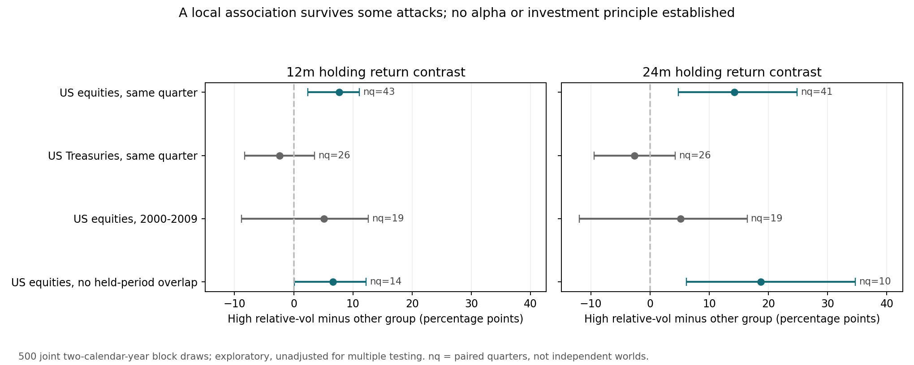

# Phase3研究与交付报告

本阶段增加了真实原信用发布和固定季度跨年代价格面板，未发现已可执行的稳健Conditional Edge。一个美国股票相对波动关联经过同日期、逐资产遗漏和非重叠反证后仍存活，最高仅C级非操作性候选；没有修改原投资规则。主面板之后已继续两个登记反证cycle，未停在扩样跑完。

## 已完成、未完成与停止边界

RAW OBSERVATIONS：2704固定选择格（26资产×2000–2025×四季度）；2113有效feature，92历史不足、395无源、104XLF隔离。六期限有效成熟标签分别{'1w': 2113, '1m': 2113, '3m': 2113, '6m': 2113, '12m': 2087, '24m': 1995}。主要12m2087、24m1995，不是2087/1995次新主观预测；概率预测新增0。273预定dossier质量见DEEP_EPISODE_LIBRARY_REPORT，完整已识别经济机制0。24个源下载成功，23个工具准入；26个计划不能说26个有效工具。

EFFECTIVE SAMPLE ASSESSMENT：101季度、26年、7市场标签（美国、中国、香港、日本、欧元区、德国、英国；五地区）、23有效工具。全球周期/同日行业相关与12/24m重叠仍在，独立N未知。跨分区每资产贪心无重叠12/24m仅480/245条，与分区内相加494/260不同；都不能称独立N。相对波动同季度严格全US非重叠对照仅14/10起点，独立世界数更小且未知。

原SLOOS104regular表，85可用公开时间（78封面精确分钟、7官方calendar日期级），19隔离；贷款标准由原人数计算，85跨2004–2025，不伪造2000–2003信用。原现托管档案仍不是第三方当年byte见证。报价是现在供应商的历史重构，不是原时点quote vintage。截止特征先统一锁；development统计锁后揭晓2024–25，但旧完整价格路径已暴露，后期仅计算隔离，不能叫真正future OOS。

执行5/21/63/126/252/504实际观察sessions，下一可交易观察开盘进入，固定50bp roundtrip假设；ETF除息经济再投资尚不等于付款日实盘，海外当地指数非直接可交易总回报。DAX供应商为performance口径，不能和其他当地价格指数混称。固定股债helper保守要求SPY/IEF/BIL共同历史，2002–2007某些IEF本可用对照因此缺失；保留原锁、报告限制，不为了补结论改实验。

**科学停止：RESEARCH_BLOCKED_BY_DATA_REQUIREMENT / NO ROBUST RETURN EDGE ESTABLISHED。** 价格状态的候选存活，不等于证明边际概率优势。下一关键问题需独立跨市场行业、历史风险暴露、原估值/预期、经营与再融资资料。继续重切同价格不能补这些识别条件。没有声称全球DATA EXHAUSTED。真实forward首月末2026-10-30尚未到，真实capture/decisions/outcomes均0，168计划slot不是实验，未部署cron。

## 用户要求的十五个回答

|问题|扩大样本后的答案|
|---|---|
|1. 原282哪些结论仍成立？|“尚无稳健通用/条件性优势”仍是证据状态；原冻结规则和weekly切换未重跑。本轮趋势均值/尾部、信用年代反转再次限制简单故事，不能说逐项重新验证原预测。|
|2. 哪些被推翻？|“增加更多记录便能证明优势”“大跌等于便宜”“信用不收紧就安全”“更高方向胜率必然更高赔率”不获支持。没有覆盖或删除原失败结果。|
|3. 哪些2016–2023特有？|同一新变量口径：高波动12m日期差2000–15约−.09pp，2016–23约+4.54pp；信用tight-minus-not早期−6.41pp、2016–23+7.43pp、2024–25−.94pp。反映样本/时代依赖，不能把整个2000–15冒称新OOS。|
|4. 哪些跨市场/regime仍存在？|没有经风险匹配并跨市场/regime验证的收益原则。US相对波动关联局部存活，但Treasury方向负、香港/德国/英国反例；年代不是有PIT证据的宏观regime标签。|
|5. 趋势是预测还是确认？|本轮没有证明独立收益预测性；正趋势组较浅回撤/较高胜率可能是确认用途线索，但确认必须能改变实际决策并胜过配置对照，尚未证明。|
|6. 估值预测什么尺度？|UNKNOWN / NOT TESTED：缺连续PIT原估值，不能用大跌或r252当估值。12/24m收益没有验证“估值只影响长期”的哲学。|
|7. 盈利修正有增量信息吗？|UNKNOWN / NOT TESTED：两原MSFT10-K/8facts不是历史一致预期revision序列，不能由实际盈利代替预期修正。|
|8. 信用是错杀过滤器吗？|重要但未识别的经济问题。原SLOOS单变量方向在年代间翻转，gate失败，Drawdown×Credit不运行；贷款标准不能代替spread/融资覆盖，不能判信用理论失败或有效。|
|9. Capital Cycle哪里最重要？|半导体、资源/能源、工业、公用事业的供给时滞机制值得优先，但历史原CapEx/需求观测未新增；八行业库是D级机制地图，不是实证排名。|
|10. 有真正Underreaction吗？|没有证实：无一致预期与首次现金流信息事件母体；波动后收益不等于慢反应。一周以上事件漂移需原发布、原预期和风险匹配对照。|
|11. 哪些只是Beta？|正绝对收益、相对全股票降回撤、公共时间反弹和行业均值都可由beta/配置解释。SPY残差仍不等于beta调整alpha；本轮未识别PAC-P3-001是否只是风险溢价/行业暴露。|
|12. 哪些可能Multiple Testing？|主两分区10272比较槽/5273可比较，相关基准槽51360及无重叠槽416；后续matched104/12可识别，遗漏年代88+无重叠2。均非独立假设计数；旧全部事后比较总数UNKNOWN。候选正区间未做选择校正，可信度降低，失败/无组格全保留。|
|13. 最接近的1–3个“钥匙”？|统计方向仅PAC-P3-001相对波动关联(C，非操作)。经济方向是原经营+再融资能否区别错杀/结构损伤(D)；原盈利信息相对起始隐含预期是否仍有增量(D)。不凑三条成立规律。|
|14. 为什么仍可能错？|存续ETF选择、原quote vintage缺失、全球周期与重叠、少量起点、beta/行业恒定暴露、尾部/执行成本、选择性关注及信息已price-in。早期区间跨零，US结果不能移植海外。|
|15. 下一笔研究成本花哪里？|先固定小跨市场同业/关闭工具及本地现金与PIT风险暴露，攻击存活vol关联；再固定连续原经营+债务到期/续借序列，区分错杀；最后原预期或可审计事件母体检验一周以上underreaction。同步真实未来捕获，不改旧规则。|

## 可审计入口与交付

先读SAMPLE_EXPANSION_PROTOCOL、EXPANDED_PANEL_REPORT、EFFECTIVE_SAMPLE_REPORT、CROSS_TIME_VALIDATION及PHASE3_SURVIVING_PRINCIPLES。机制专题为INDUSTRY_MECHANISM_LIBRARY、CRISIS_VS_CORRECTION_REPORT、TEMPORARY_VS_STRUCTURAL_REPORT、UNDERREACTION_REPORT；全部比较计入MULTIPLE_TESTING_LEDGER。

源/代码/锁/标签/完整失败格及counterexamples在research/phase3/。独立QA重新计算13086成熟horizon路径、配对与固定配置、全部统计/块区间；旧3366文件SHA守恒。具体验收以audit的最终JSON为准；工程计算检查不是新增投资样本。

最终CURRENT_FRAMEWORK仅更新研究状态与计数，9个operative字段逐一和Phase2基线相等，validated_principles仍空、live_signal_generation_enabled仍false。新增主观概率0，无新增校准成功声明。上轮Phase2包完整保留；Phase3完整包包括上轮便携研究与本轮源、代码、报告、checkpoint，原重复大输入用无损blueprint恢复并核验565原SHA。

## 前瞻工程修正与独立科学验收

原forward v001没有真实capture，独立QA发现其波动/峰值口径与主panel不完全相同、BIL仅首尾匹配不足；原代码/锁保留为未启用工程beta。新增 scripts/phase3_forward_v002.py 与research/phase3/forward_v002锁，精确采用simple-return/last252peak/505参考端点、完整held-session SHA failclosed并比较9operative基线；14合成流程检查通过，今天实际capture拒绝于联网与写decision目录之前。未来应执行v002，不改变已有历史/概率。尚未部署调度、真实forward仍0。

独立MATCHED_VOL_QA.v007核验104matched+88敏感度与5382数值/CI字段PASS；所有3366旧immutable/9operative不变。严格全US不重叠14/10季度含135/96资产行，仍非独立N。完整图及CSV只呈现已锁数值，无新增test：research/phase3/figures/relative_vol_falsification.png。

最终交付放在界面支持的原生共享目录 `sandbox:/workspace/scratch/investment_research_delivery_20261009/`。完整包、原Phase2包、小报告包各自可下载；源代码、标签/锁、原数据、报告和研究记忆全部保留。565重复原输入以无损blueprint重构，完整包不是report-only包。最终forward独立QA v008和其他路径/统计/反证QA全部PASS；原3366/9operative不变。
